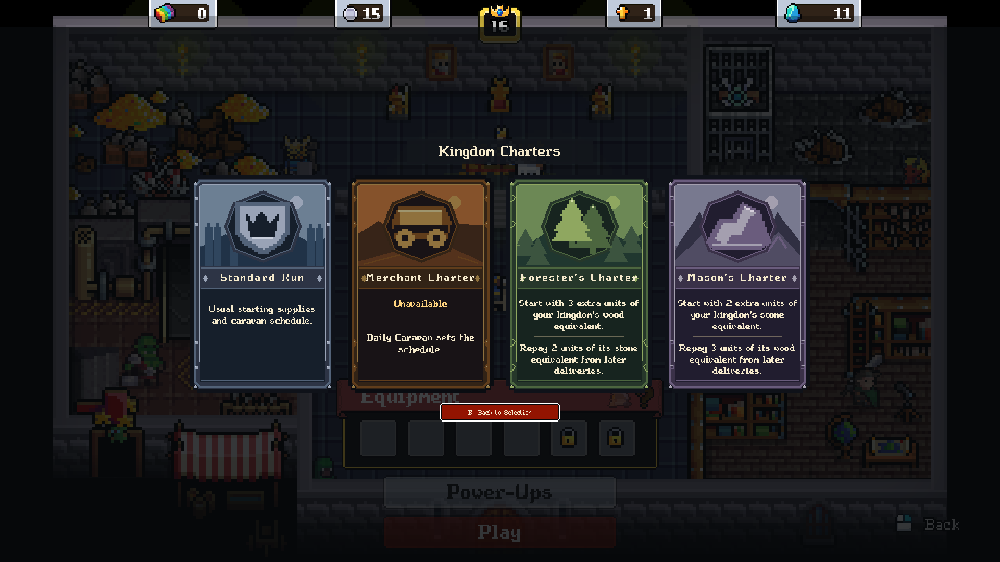
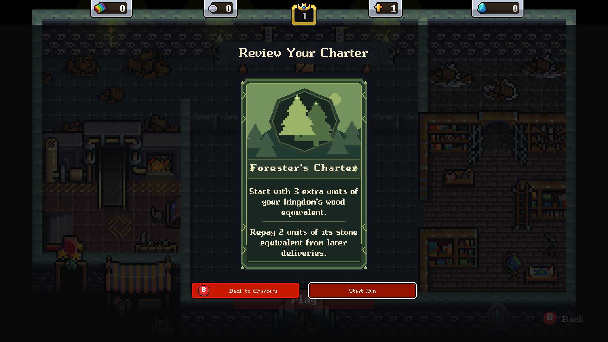
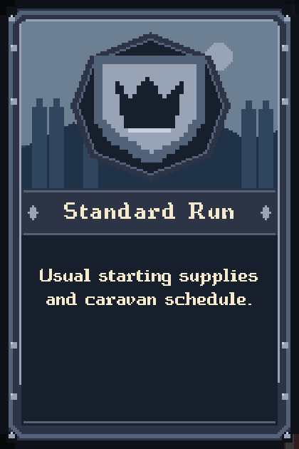
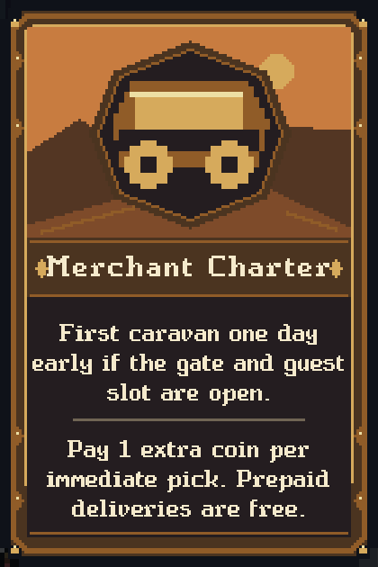
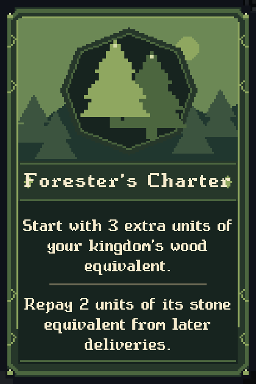
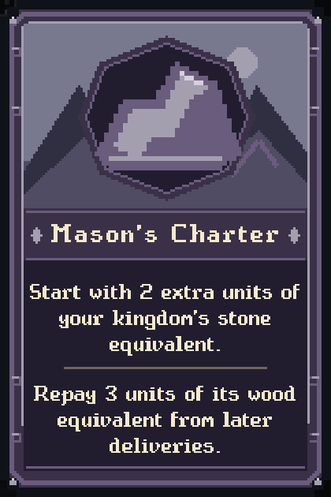

# Kingdom Charters

At hero selection, choose a charter for your next run. Bring the first caravan forward for an extra coin per pick, borrow building materials against future deliveries, or keep the usual rules with Standard Run.

## Features

- **Standard Run** keeps the usual starting supplies, caravan schedule and prices.
- **Merchant Charter** lets the first scheduled caravan arrive one day early if the gate is open and the guest slot is free. If it cannot arrive early, it keeps its appointment. Each immediate item pick costs one extra coin on top of its shop price. Browsing and declining are free.
- **Forester’s Charter** gives you 3 extra units of your kingdom’s wood equivalent at the start. Repay the next 2 units of its stone equivalent delivered to your stores.
- **Mason’s Charter** gives you 2 extra units of your kingdom’s stone equivalent at the start. Repay the next 3 units of its wood equivalent delivered to your stores.
- A badge above the unit cards shows the owed material’s icon and the remaining balance. If Forester owes 1 stone when a delivery brings 3, you keep 2 and the debt clears.

## How to Use

1. Choose **Play** at hero selection. The chooser starts on **Standard Run**. Compare the cards with the D-pad or left and right arrow keys. Press **A** on an Xbox-style controller, press **Enter**, or click a card to review its terms. Dimmed cards explain why they are unavailable.
2. Choose **Start Run** to confirm. Release the confirm button between selecting a charter and starting the run. To compare another charter, use **B**, **Escape**, or **Back to Charters**. Use **Back to Selection** on the chooser to return to hero selection.
3. For Forester or Mason, check the material names at the start of the run. **Accept Charter** takes the deal. **Standard Run** declines it. The choice and outstanding debt follow the run through saves and reloads. Restarting day one before the first checkpoint keeps the choice and resets its opening supplies and debt.

## Screenshots

Captured in Super Fantasy Kingdom 0.8.069 with a virtual controller.

*Human, 1×. Each card shows its terms. Merchant is dimmed because Daily Caravan sets the schedule.*

*Undead, 1.5×. Review the supply grant and repayment before confirming Start Run.*

### Charter Cards

The individual cards are cropped from 1.5× in-game renders.

| Charter | Rules | Card |
| --- | --- | --- |
| Standard Run | Usual starting supplies, caravan schedule and prices. |  |
| Merchant Charter | The first scheduled caravan can arrive one day early. Immediate picks cost 1 extra coin. |  |
| Forester’s Charter | Gain 3 wood-equivalent materials. Repay 2 stone-equivalent materials from later deliveries. |  |
| Mason’s Charter | Gain 2 stone-equivalent materials. Repay 3 wood-equivalent materials from later deliveries. |  |

## Compatibility

- Verified on Super Fantasy Kingdom **0.8.070**. Challenge runs use their own rules. Existing saves without a charter continue under standard rules.
- Supply charters require two distinct materials with usable stores. If the kingdom lacks a pair, the opening confirmation offers Standard Run. Debt collection begins after opening grants from the king’s dialogue, the starter screen and the game’s starting-resource grant.
- [Visitor Calendar](https://thunderstore.io/c/super-fantasy-kingdom/p/GKJ/VisitorCalendar/) shows an early arrival once the date is known. The debt badge clears the compact strip and expanded ledger in [Daybook](https://thunderstore.io/c/super-fantasy-kingdom/p/GKJ/Daybook/).
- [Daily Caravan](https://thunderstore.io/c/super-fantasy-kingdom/p/GKJ/DailyCaravan/) makes Merchant unavailable for new runs. Loading it during an existing Merchant run suspends both the early arrival and the extra fee.
- [Caravan Commissions](https://thunderstore.io/c/super-fantasy-kingdom/p/GKJ/CaravanCommissions/) deliveries are prepaid. Collecting one costs no charter fee, even after deferring it. If another mod hooks caravan arrival or eligibility, Merchant keeps the existing schedule and its immediate-pick fee. The picker shows those terms before you commit.
- [ExtraStartingCarrier](https://thunderstore.io/c/super-fantasy-kingdom/p/ownlyme/ExtraStartingCarrier/) can add its carrier alongside the starting charter. With [CheatMenu](https://thunderstore.io/c/super-fantasy-kingdom/p/ILM/CheatMenu/) yield changes, the charter takes only the outstanding repayment from the adjusted delivery.

## Installation

1. Choose **Install with App** and select your Super Fantasy Kingdom profile.
2. Enable Kingdom Charters and both required packages, [BepInExPack](https://thunderstore.io/c/super-fantasy-kingdom/p/BepInEx/BepInExPack/) 5.4.2305 and [HideManagerGameObject Config](https://thunderstore.io/c/super-fantasy-kingdom/p/BepInEx/HideManagerGameObject_Config/) 5.4.2304.
3. Launch with **Start modded** and choose **Play** at hero selection for a new normal run.

The 0.8.070 Save and fresh Continue check covered Human Forester and Undead Mason with partially repaid debt and verified each native tavern backup. Offline compatibility checks covered 0.8.069, ExtraStartingCarrier 1.0.0, and CheatMenu 1.0.3 at 1× and 3× yield. See [Contributing](CONTRIBUTING.md) for the offline harness.

The mod code is [MIT licensed](LICENSE). Super Fantasy Kingdom, its assets and third-party dependencies retain their respective licenses.

[Support GKJ Games on Ko-fi](https://ko-fi.com/gkj_games)
