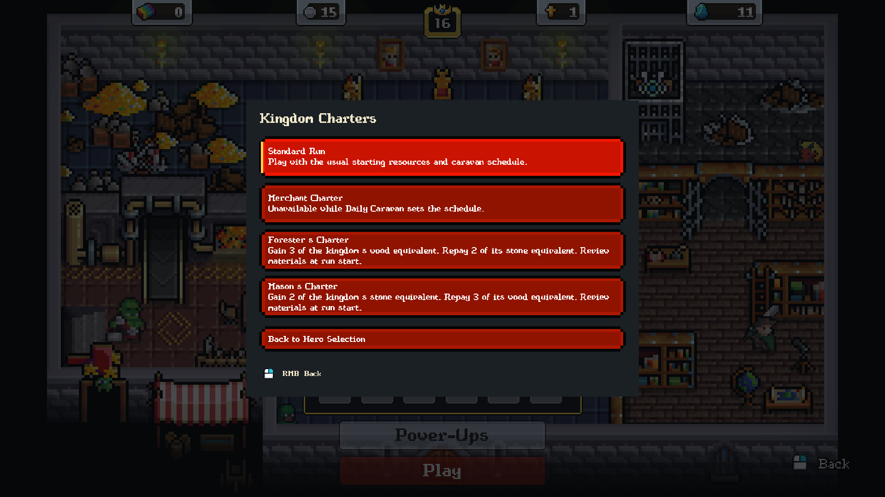
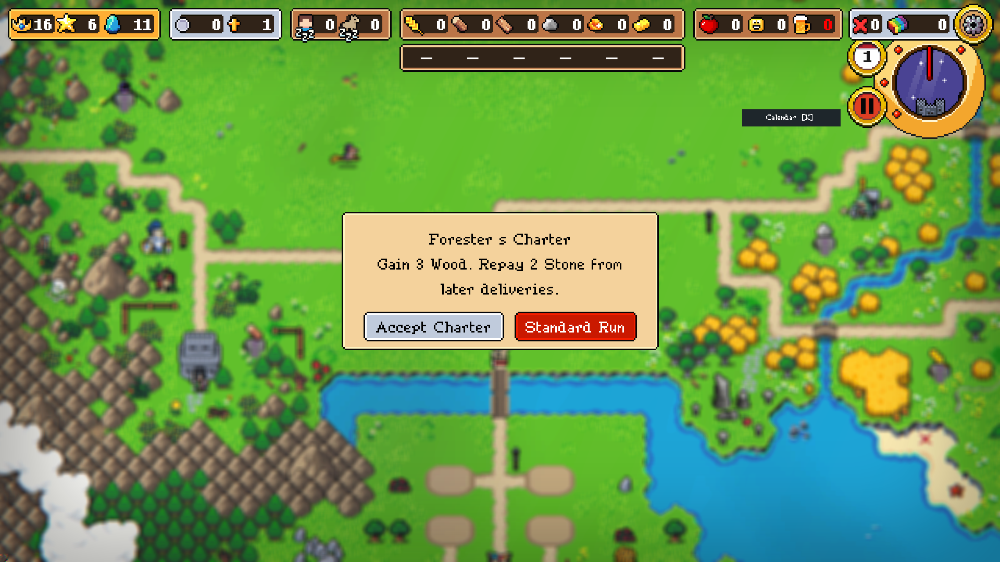

# Kingdom Charters

Start a reign with an early caravan or extra building materials, and choose the cost you are willing to pay. At hero selection, press **Play**, inspect a charter, then choose **Start Run**. **Standard Run** is focused first each time.



*The picker at 1× UI scale. Daily Caravan is enabled in this run, so the Merchant row explains why it is unavailable.*

| Choice | What you get | What you pay |
| --- | --- | --- |
| Standard Run | The usual starting supplies and caravan schedule. | No charter cost. |
| Merchant Charter | The first scheduled caravan can arrive one day early if the gate is open and the guest slot is free. A missed early visit keeps its original appointment. | One extra coin per immediate item pick, on top of its shop price. Browsing, declining and collecting a prepaid commission are free of the charter fee. |
| Forester’s Charter | Three extra units of the kingdom’s wood equivalent with starting supplies. | The next two units of its stone equivalent delivered to your stores. |
| Mason’s Charter | Two extra units of the kingdom’s stone equivalent with starting supplies. | The next three units of its wood equivalent delivered to your stores. |

## Before taking a supply charter

At the start of the run, the game names the materials for your kingdom. Choose **Accept Charter** to take the deal or **Standard Run** to decline. A kingdom needs two distinct materials with usable stores. If it lacks a pair, the confirmation explains why Standard Run is the available choice.



*Human Kingdom at 1.5× UI scale. You can still choose Standard Run before receiving the three Wood.*

Starting grants made during the king’s opening callback, the starter screen or the game’s starting-resource grant are included before debt collection begins. The outstanding debt appears at the bottom center of the HUD. For example, if Forester owes one Stone and you receive three, two enter your stock and the debt clears.

## Saves and other mods

- The choice and remaining debt travel with the run’s save and backup. Restarting day one before the first checkpoint keeps your choice and starts the opening again. Saves created without a charter use standard rules. Challenge runs skip the picker.
- **Daily Caravan** owns the schedule while it is loaded. Merchant is unavailable for new runs, and both Merchant effects are suspended on an existing Merchant run.
- With **Caravan Commissions**, prepaid items remain free of the charter fee, including after a deferred delivery.
- If another mod hooks caravan arrival or eligibility, Merchant leaves the existing schedule in place and retains its immediate-pick fee. The picker shows these terms before you commit. This also applies to mods that only observe those hooks.

## Install and play

Install Kingdom Charters and its listed dependencies in your Super Fantasy Kingdom profile, then choose **Start modded**. For a local ZIP, use **Settings → Import local mod** and select `KingdomCharters-0.1.0.zip`.

Use the game’s menu navigation, Submit and Back actions with a controller. On the review screen, release Submit before pressing it again to start the run. Back returns to the charter you inspected. Mouse selection and the keyboard arrow keys, Enter and Escape also work.

Tested on Windows with Super Fantasy Kingdom 0.8.067. The picker and native confirmation were checked at 1920 × 1080 at 1× and 1.5× UI scales. The controller checks used simulated input through the game’s Input System.

## Building and testing

Build against your installed game and a BepInEx 5 profile, then package and test the Release DLL.

```powershell
dotnet build KingdomCharters.csproj -c Release
python package.py
python tests/smoke.py
```

The ZIP is written under `dist/`. For other installations, set the MSBuild properties `GameDir` and `ProfileDir`, and pass `--game` and `--profile` to the smoke test. The profile must contain the BepInEx core assemblies. The offline harness uses the installed game’s embedded Mono without launching a player.

For companion regression checks, run `python tests/smoke.py --compat-dlls PATH` with the unpacked ExtraStartingCarrier 1.0.0, CheatMenu 1.0.3, DailyCaravan 0.1.0 and CaravanCommissions 0.1.0 DLLs in one directory. These mods are optional for gameplay.

Bug reports and contributions are welcome. The original mod code is MIT licensed. Super Fantasy Kingdom, its assets and third-party dependencies retain their respective licenses. [Contributing](https://github.com/GKJ-Super-Fantasy-Kingdom/kingdom-charters/blob/main/CONTRIBUTING.md) · [License](https://github.com/GKJ-Super-Fantasy-Kingdom/kingdom-charters/blob/main/LICENSE)
