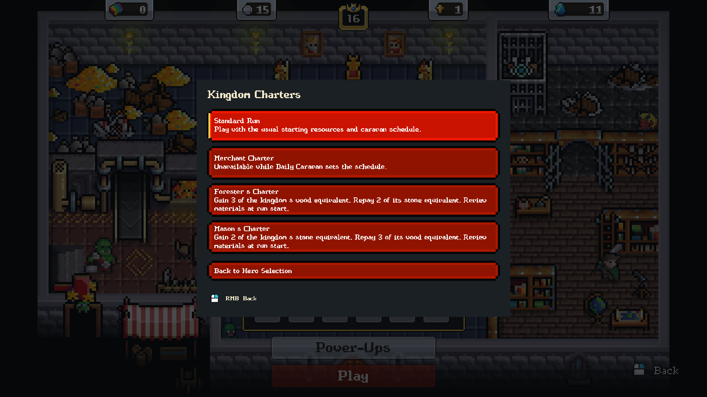
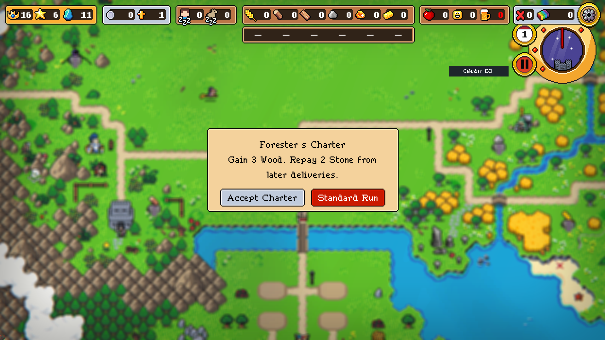

# Kingdom Charters

At hero selection, choose a charter for your next run. Bring the first caravan forward for an extra coin per pick, borrow building materials against future deliveries, or keep the usual rules with Standard Run.

## Features

- **Standard Run** keeps the usual starting supplies, caravan schedule and prices.
- **Merchant Charter** lets the first scheduled caravan arrive one day early if the gate is open and the guest slot is free. If it cannot arrive early, it keeps its appointment. Each immediate item pick costs one extra coin on top of its shop price. Browsing and declining are free.
- **Forester’s Charter** gives you 3 extra units of your kingdom’s wood equivalent at the start. Repay the next 2 units of its stone equivalent delivered to your stores.
- **Mason’s Charter** gives you 2 extra units of your kingdom’s stone equivalent at the start. Repay the next 3 units of its wood equivalent delivered to your stores.
- The bottom-center HUD shows your remaining debt. If Forester owes 1 stone when a delivery brings 3, you keep 2 and the debt clears.

## How to Use

1. Choose **Play** at hero selection. The picker starts on **Standard Run**. Move with the D-pad or the up and down arrow keys. Press **A** on an Xbox-style controller, press **Enter**, or click a row to review its terms.
2. Choose **Start Run** to confirm. Release the confirm button between selecting a charter and starting the run. To compare another charter, use **B**, **Escape**, or the on-screen **Back to Charters** button.
3. For Forester or Mason, check the material names at the start of the run. **Accept Charter** takes the deal. **Standard Run** declines it. The choice and outstanding debt follow the run through saves and reloads. Restarting day one before the first checkpoint keeps the choice and resets its opening supplies and debt.

## Screenshots

*Picker at 1× UI scale. The Merchant row explains why it is unavailable in this run.*

*Forester at 1.5× UI scale. You can still choose Standard Run before receiving the Wood.*

Both captures are from Kingdom Charters 0.1.0 on Windows, in Super Fantasy Kingdom 0.8.067 at 1920 × 1080. Controller checks used simulated input through the game’s Input System.

## Compatibility

- Challenge runs skip the picker. Existing saves without a charter continue under standard rules.
- Supply charters require two distinct materials with usable stores. If the kingdom lacks a pair, the opening confirmation offers Standard Run. Debt collection begins after opening grants from the king’s dialogue, the starter screen and the game’s starting-resource grant.
- [Daily Caravan](https://thunderstore.io/c/super-fantasy-kingdom/p/GKJ/DailyCaravan/) makes Merchant unavailable for new runs. Loading it during an existing Merchant run suspends both the early arrival and the extra fee.
- [Caravan Commissions](https://thunderstore.io/c/super-fantasy-kingdom/p/GKJ/CaravanCommissions/) deliveries are prepaid. Collecting one costs no charter fee, even after deferring it. If another mod hooks caravan arrival or eligibility, Merchant keeps the existing schedule and its immediate-pick fee. The picker shows those terms before you commit.
- With [ExtraStartingCarrier](https://thunderstore.io/c/super-fantasy-kingdom/p/ownlyme/ExtraStartingCarrier/) 1.0.0, the extra carrier and the charter supplies each apply once. With [CheatMenu](https://thunderstore.io/c/super-fantasy-kingdom/p/ILM/CheatMenu/) 1.0.3, the charter takes only the outstanding debt from the adjusted production yield. Offline checks covered 1× and 3× yield.

## Installation

1. Choose **Install with App** and select your Super Fantasy Kingdom profile.
2. Enable Kingdom Charters and both required packages, [BepInExPack](https://thunderstore.io/c/super-fantasy-kingdom/p/BepInEx/BepInExPack/) 5.4.2305 and [HideManagerGameObject Config](https://thunderstore.io/c/super-fantasy-kingdom/p/BepInEx/HideManagerGameObject_Config/) 5.4.2304.
3. Launch with **Start modded** and choose **Play** at hero selection for a new normal run.
